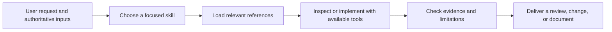

# Evidence-Driven Agent Skills

Four reusable skills by **Fan Yupei** for reviewing product interfaces, refining visual design, reconstructing development history, and turning engineering experience into future decisions.

These are agent instructions with supporting references. They guide an agent that already has the necessary tools; they are not a standalone application or a hosted service.

## Primary capabilities

| Skill | Main job | Distinctive mechanism |
| --- | --- | --- |
| [Product UI QA](skills/product-ui-qa/README.md) | Decide whether a product interface supports its users and is ready | Derive components from user decisions; verify relevant rendered states; challenge completion in a second review |
| [Visual Convergence](skills/visual-convergence/README.md) | Bring an existing UI toward an approved visual direction | Separate token correctness from perceptual composition; diagnose distribution, hierarchy, and visual weight |
| [Project History Archivist](skills/project-history-archivist/README.md) | Reconstruct accessible project conversations and development into an auditable DOCX | Reconcile a conversation inventory, preserve chronology, and corroborate claims against Git |
| [Software History Lessons](skills/software-history-lessons/README.md) | Extract transferable engineering knowledge and apply it to another product | Trace historical evidence through applicability conditions to a recommendation and validation plan |

## Supporting capabilities

- Risk-based state coverage, accessibility review, and explicit verification limits.
- Project-specific visual decisions kept outside reusable skill instructions.
- Durable evidence records that survive long investigations and context limits.
- A Python ledger checker for structural consistency in history archives.
- Reference files loaded only when the current task needs them.

For academic work, see the separately maintained [Adaptive Academic Note Architect](https://github.com/FAN0020/adaptive-academic-note-architect): complete source-grounded notes, bilingual explanations, and document helpers.

## Workflow



Use Product UI QA for task fit and product quality; add Visual Convergence when an approved aesthetic reference exists. Use Project History Archivist for conversation-led reconstruction; feed its report to Software History Lessons when reusable experience or a new product recommendation is requested. Each skill can also run independently.

## Architecture

```text
skills/<skill-name>/
├── SKILL.md          # Trigger, decision rules, workflow, completion criteria
├── README.md         # Human-facing capabilities, architecture, comparisons, usage
├── agents/           # Optional Codex display metadata
├── references/       # Conditional, detailed operating guidance
└── scripts/          # Only the archivist includes an executable helper
docs/
├── inventory-and-selection.md
├── comparisons.md
├── comparison-sources.json
├── source-manifest.json
└── verification.md
```

The agent performs semantic judgment. External browser/native UI tools supply rendered evidence; Git supplies repository evidence; an available document toolchain produces and renders DOCX files. The archive checker validates record structure, not the truth of a conversation or historical claim.

## Comparison and selection

The [full inventory](docs/inventory-and-selection.md) covers 14 custom or locally tailored skills found in the reviewed personal directories, and separates five upstream installations. The [comparison](docs/comparisons.md) explains why these four were selected alongside the existing academic skill, using dated, commit-pinned primary sources.

The advantages are **workflow design differences**, not measured win rates. No controlled comparison of model output quality has been run. Other tools may be a better fit for quick code review, direct transcript export, or a lightweight retrospective.

## Install and use

For Codex, clone the repository, then copy the skill folders into your personal skills directory. The installer below refuses to overwrite existing folders. Set `CODEX_HOME` if you use a custom location.

```sh
git clone https://github.com/FAN0020/evidence-driven-agent-skills.git
cd evidence-driven-agent-skills
python3 - <<'PY'
import os
import shutil
from pathlib import Path

names = ["product-ui-qa", "visual-convergence",
         "project-history-archivist", "software-history-lessons"]
source = Path("skills")
target = Path(os.environ.get("CODEX_HOME", str(Path.home() / ".codex"))) / "skills"
conflicts = [name for name in names if (target / name).exists() or (target / name).is_symlink()]
if conflicts:
    raise SystemExit("Existing skills; review them before updating: " + ", ".join(conflicts))
target.mkdir(parents=True, exist_ok=True)
for name in names:
    shutil.copytree(source / name, target / name)
    print("Installed", target / name)
PY
```

To install one skill, reduce `names` to its directory name. Invoke it with `$product-ui-qa`, `$visual-convergence`, `$project-history-archivist`, or `$software-history-lessons`, followed by the task and relevant inputs. Each README includes a concrete prompt.

Other agents can read the `SKILL.md` format, but tool names, discovery paths, and conversation access vary. Compatibility with other hosts has not been runtime-tested.

## Requirements and verification

The instruction-only skills have no package dependencies. The optional archive checker needs **Python 3.10+** and uses the standard library. Actual UI inspection, history retrieval, and DOCX rendering depend on tools in the host environment. Companion skills mentioned in the instructions are optional and are not bundled here.

See [verification](docs/verification.md) for the exact packaging checks and helper checks performed. No product UI, private conversation archive, or model benchmark is included in this repository.

## Maintenance and license

Original skill files were snapshotted on **2026-10-16**; their hashes are recorded in [source-manifest.json](docs/source-manifest.json). Public packaging adds READMEs, examples, metadata where missing, and comparison documentation. The installed personal copies are maintained separately.

Use issues to report a concrete failure mode, expected behavior, and a sanitized example. Do not upload private conversation exports or credentials.

MIT licensed; see [LICENSE](LICENSE). Referenced third-party projects retain their own licenses and are not redistributed in this collection.
