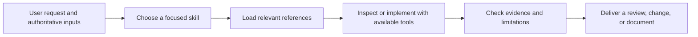

# Evidence-Driven Agent Skills

[English](#english) | [中文版](#chinese-version)

<a name="english"></a>

Four reusable skills by **Fan Yupei** for reviewing product interfaces, refining visual design, reconstructing development history, and turning engineering experience into future decisions.

These are agent instructions with supporting references. They guide an agent that already has the necessary tools; they are not a standalone application or a hosted service.

## Primary capabilities

| Skill | Main job | Distinctive mechanism |
| --- | --- | --- |
| [Product UI QA](skills/product-ui-qa/README.md) | Decide whether a product interface supports its users and is ready | Derive components from user decisions; verify relevant rendered states; challenge completion in a second review |
| [Visual Convergence](skills/visual-convergence/README.md) | Bring an existing UI toward an approved visual direction | Separate token correctness from perceptual composition; diagnose distribution, hierarchy, and visual weight |
| [Project History Archivist](skills/project-history-archivist/README.md) | Reconstruct accessible project conversations and development into an auditable DOCX | Reconcile a conversation inventory, preserve chronology, and corroborate claims against Git |
| [Software History Lessons](skills/software-history-lessons/README.md) | Extract transferable engineering knowledge and apply it to another product | Trace historical evidence through applicability conditions to a recommendation and validation plan |

## Supporting capabilities

- Risk-based state coverage, accessibility review, and explicit verification limits.
- Project-specific visual decisions kept outside reusable skill instructions.
- Durable evidence records that survive long investigations and context limits.
- A Python ledger checker for structural consistency in history archives.
- Reference files loaded only when the current task needs them.

For academic work, see the separately maintained [Adaptive Academic Note Architect](https://github.com/FAN0020/adaptive-academic-note-architect): complete source-grounded notes, bilingual explanations, and document helpers.

## Workflow



Use Product UI QA for task fit and product quality; add Visual Convergence when an approved aesthetic reference exists. Use Project History Archivist for conversation-led reconstruction; feed its report to Software History Lessons when reusable experience or a new product recommendation is requested. Each skill can also run independently.

## Architecture

```text
skills/<skill-name>/
├── SKILL.md          # Trigger, decision rules, workflow, completion criteria
├── README.md         # Human-facing capabilities, architecture, comparisons, usage
├── agents/           # Optional Codex display metadata
├── references/       # Conditional, detailed operating guidance
└── scripts/          # Only the archivist includes an executable helper
docs/
├── inventory-and-selection.md
├── comparisons.md
├── comparison-sources.json
├── source-manifest.json
└── verification.md
```

The agent performs semantic judgment. External browser/native UI tools supply rendered evidence; Git supplies repository evidence; an available document toolchain produces and renders DOCX files. The archive checker validates record structure, not the truth of a conversation or historical claim.

## Comparison and selection

The [full inventory](docs/inventory-and-selection.md) covers 14 custom or locally tailored skills found in the reviewed personal directories, and separates five upstream installations. The [comparison](docs/comparisons.md) explains why these four were selected alongside the existing academic skill, using dated, commit-pinned primary sources.

The advantages are **workflow design differences**, not measured win rates. No controlled comparison of model output quality has been run. Other tools may be a better fit for quick code review, direct transcript export, or a lightweight retrospective.

## Install and use

For Codex, clone the repository, then copy the skill folders into your personal skills directory. The installer below refuses to overwrite existing folders. Set `CODEX_HOME` if you use a custom location.

```sh
git clone https://github.com/FAN0020/evidence-driven-agent-skills.git
cd evidence-driven-agent-skills
python3 - <<'PY'
import os
import shutil
from pathlib import Path

names = ["product-ui-qa", "visual-convergence",
         "project-history-archivist", "software-history-lessons"]
source = Path("skills")
target = Path(os.environ.get("CODEX_HOME", str(Path.home() / ".codex"))) / "skills"
conflicts = [name for name in names if (target / name).exists() or (target / name).is_symlink()]
if conflicts:
    raise SystemExit("Existing skills; review them before updating: " + ", ".join(conflicts))
target.mkdir(parents=True, exist_ok=True)
for name in names:
    shutil.copytree(source / name, target / name)
    print("Installed", target / name)
PY
```

To install one skill, reduce `names` to its directory name. Invoke it with `$product-ui-qa`, `$visual-convergence`, `$project-history-archivist`, or `$software-history-lessons`, followed by the task and relevant inputs. Each README includes a concrete prompt.

Other agents can read the `SKILL.md` format, but tool names, discovery paths, and conversation access vary. Compatibility with other hosts has not been runtime-tested.

## Requirements and verification

The instruction-only skills have no package dependencies. The optional archive checker needs **Python 3.10+** and uses the standard library. Actual UI inspection, history retrieval, and DOCX rendering depend on tools in the host environment. Companion skills mentioned in the instructions are optional and are not bundled here.

See [verification](docs/verification.md) for the exact packaging checks and helper checks performed. No product UI, private conversation archive, or model benchmark is included in this repository.

## Maintenance and license

Original skill files were snapshotted on **2026-10-16**; their hashes are recorded in [source-manifest.json](docs/source-manifest.json). Public packaging adds READMEs, examples, metadata where missing, and comparison documentation. The installed personal copies are maintained separately.

Use issues to report a concrete failure mode, expected behavior, and a sanitized example. Do not upload private conversation exports or credentials.

MIT licensed; see [LICENSE](LICENSE). Referenced third-party projects retain their own licenses and are not redistributed in this collection.

---

<a name="chinese-version"></a>

## 中文版

[返回英文版](#english)

四个由 **Fan Yupei** 整理的可复用 skills，用于审查产品界面、调整视觉设计、重建开发历史，以及将工程经验转化为后续项目的决策依据。

每个 skill 由供智能体执行的指令和参考资料组成，需要运行环境提供相应工具。它们本身不提供独立应用或托管服务。

### 主要功能

| Skill | 核心任务 | 特色机制 |
| --- | --- | --- |
| [Product UI QA](skills/product-ui-qa/README.md#chinese-version) | 判断产品界面能否支持用户完成任务，以及是否达到交付要求 | 从用户决策推导组件，检查关键渲染状态，再通过第二轮审查挑战“已完成”的结论 |
| [Visual Convergence](skills/visual-convergence/README.md#chinese-version) | 让现有界面逐步接近已确认的视觉方向 | 区分设计参数正确与整体观感正确，诊断视觉分布、层级和权重 |
| [Project History Archivist](skills/project-history-archivist/README.md#chinese-version) | 将可访问的项目对话和开发记录重建为可审计的 DOCX | 核对对话清单、保留时间顺序，并使用 Git 交叉验证重要陈述 |
| [Software History Lessons](skills/software-history-lessons/README.md#chinese-version) | 提炼可迁移的工程经验，并应用于另一个产品 | 将历史证据、适用条件、建议和验证方案串联起来 |

### 辅助功能

- 根据风险选择界面状态覆盖范围，进行无障碍审查，并明确验证边界。
- 将项目特定的视觉决策保存在项目中，避免混入通用 skill 规则。
- 使用可持久保存的证据记录，支持长时间调查和上下文受限时的继续处理。
- 提供 Python 归档台账检查器，检查历史记录的结构一致性。
- 按当前任务需要加载参考文件。

学术笔记工作可使用独立维护的 [Adaptive Academic Note Architect](https://github.com/FAN0020/adaptive-academic-note-architect#chinese-version)，支持基于原材料的完整笔记重构、双语解释和文档辅助工具。

### 工作流程


使用 Product UI QA 判断界面的任务适配性和产品质量；已有确认的视觉参考时，可配合 Visual Convergence。使用 Project History Archivist 重建以对话为线索的开发历史；需要提炼经验或为新产品提出建议时，可将其报告作为 Software History Lessons 的输入。各 skill 也可单独使用。

### 架构设计

```text
skills/<skill-name>/
├── SKILL.md          # 适用场景、决策规则、流程与完成标准
├── README.md         # 面向读者的功能、架构、比较与使用说明
├── agents/           # 可选的 Codex 显示元数据
├── references/       # 按需加载的详细执行指南
└── scripts/          # 本集合仅历史归档 skill 提供可执行辅助脚本
docs/
├── inventory-and-selection.md  # 完整清单与筛选依据
├── comparisons.md             # 同类比较
├── comparison-sources.json    # 比较来源及固定版本
├── source-manifest.json       # 原始文件哈希
└── verification.md            # 已完成的验证与未验证范围
```

智能体负责语义判断；浏览器或原生界面工具提供实际渲染证据；Git 提供仓库证据；可用的文档工具链负责生成和渲染 DOCX。归档检查器检查记录结构，无法证明对话内容或历史陈述真实。

### 同类比较与筛选

[完整清单](docs/inventory-and-selection.md) 覆盖已检查个人目录中的 14 个自定义或本地定制 skills，并将 5 个上游安装项单独列出。[同类比较](docs/comparisons.md) 使用注明核对日期、固定到具体 commit 的一手来源，解释为何选择这四个 skills，并将已有的学术笔记 skill 一同展示。

这里的优势指**工作流设计和任务适配性的差异**，不代表实测胜率。尚未进行模型输出质量的受控对照实验。快速代码审查、直接导出对话或轻量复盘等任务，可能更适合相应的专门工具。

### 安装与使用

在 Codex 中，先克隆仓库，再将所需 skill 文件夹复制到个人 skills 目录。可直接运行上方 [Install and use](#install-and-use) 中的完整命令：默认安装到 `~/.codex/skills`；使用自定义位置时设置 `CODEX_HOME`。安装代码会拒绝覆盖已有文件夹，更新前应先检查现有版本。

只安装一个 skill 时，将命令中的 `names` 列表缩减为对应目录名。安装后使用 `$product-ui-qa`、`$visual-convergence`、`$project-history-archivist` 或 `$software-history-lessons`，随后写明任务并提供相关输入。各 skill 的 README 均包含中文调用示例。

其他智能体也可能支持 `SKILL.md` 格式，但工具名称、发现路径和对话访问能力因环境而异；尚未在其他宿主中完成运行验证。

### 环境要求与验证

纯指令部分没有软件包依赖。可选的归档检查器需要 **Python 3.10+**，仅使用标准库。实际界面检查、历史检索和 DOCX 渲染依赖宿主环境提供的工具。指令中提及的配套 skills 为可选项，本仓库不附带它们。

具体打包检查与辅助脚本检查见 [验证记录](docs/verification.md)。仓库不包含产品界面、私人对话档案或模型基准测试数据。

### 维护与许可

原始 skill 文件的快照日期为 **2026-10-16**，哈希记录在 [source-manifest.json](docs/source-manifest.json)。公开版本补充了 README、示例、缺失的显示元数据与比较文档；本机安装的个人副本独立维护。

通过 issues 反馈时，请提供具体问题、预期行为与脱敏示例。不要上传私人对话导出或凭据。

本仓库采用 MIT 许可，详见 [LICENSE](LICENSE)。引用的第三方项目保留各自许可，本集合不重新分发其内容。
