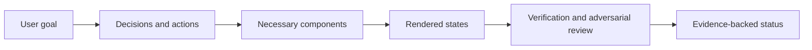

# Product UI QA

[English](#english) | [中文版](#chinese-version)

<a name="english"></a>

Review, implement, and verify interfaces against the user's actual task, including whether each visible component needs to exist.

## Primary capabilities

| Capability | What it does |
| --- | --- |
| Component necessity | Derives decisions, information, actions, and visible state before choosing UI components; classifies redundant or implementation-driven elements |
| Product-level quality gates | Reviews truthful status, recovery, task completion, identity boundaries, information hierarchy, and consistency |
| State-based verification | Selects meaningful combinations of data volume, async state, permissions, connectivity, input, viewport, and language |
| Two-pass completion review | Checks requirements first, then challenges the rendered product for unnecessary, misleading, missing, or inaccessible UI |

## Supporting capabilities

- P0–P3 severity definitions and a structured QA report.
- Review-only, implementation, and implementation-plus-verification modes.
- Manual and automated accessibility evidence kept distinct.
- A removal challenge that preserves essential navigation, safety, trust, and recovery.

## Workflow

1. Establish requirements and the primary user journey.
2. Run the component necessity gate before a new screen or substantial redesign.
3. Choose relevant quality gates and a risk-based state matrix.
4. Implement if authorized, then inspect the running interface.
5. Audit the rendered component set and conduct a fresh adversarial review.
6. Fix in-scope critical defects, rerun affected checks, and report evidence and gaps.



## Architecture

[SKILL.md](SKILL.md) coordinates seven focused references: [component necessity](references/component-necessity-and-minimal-ui.md), [quality gates](references/ui-quality-gates.md), [state matrix](references/state-matrix.md), [semantic audit](references/semantic-ui-audit.md), [accessibility](references/accessibility-checklist.md), [adversarial review](references/adversarial-review.md), and the [report template](references/final-qa-report-template.md).

This package contains no browser runner. The host's browser or native UI tools provide screenshots and interaction evidence. Existing project test tools supply automated checks. Companion skills can assist when installed; they are not required to read or apply this framework.

## Comparison and advantages

| Related skill | Useful distinction |
| --- | --- |
| Vercel `web-design-guidelines` | A focused code review against maintained interface rules. This skill adds a component-necessity decision chain, relevant runtime states, and a product-level completion report. |
| Anthropic `webapp-testing` | Supplies concrete Playwright interaction and server-management mechanics. This skill supplies the product judgments that determine which states and user outcomes those mechanics should prove. |

The strongest reason to choose this skill is a UI that works technically but contains unnecessary controls, misleading states, or an incomplete recovery journey. Choose the narrower alternatives when file-level findings or browser mechanics are sufficient. Sources and review versions: [comparison record](../../docs/comparisons.md#product-ui-qa).

## Usage

Install with the [collection instructions](../../README.md#install-and-use), then provide the running application, requirements, and intended mode:

```text
$product-ui-qa
Review this document-upload workflow without changing code. The primary user
must upload a file, understand processing progress, recover from failure, and
open the result. Check empty, processing, failed, and completed states at the
main desktop and mobile viewports. Return prioritized findings with evidence.
```

**Illustrative finding, not a measured result:** a permanent “worker version” card may be moved to diagnostics if it supports no user decision, while a retry control remains visible in the failed state.

**Output:** a scoped QA report, evidence locations, defects and severity, fixes when requested, and a supported final status.

## Limits and verification

Rendered inspection is necessary for visual claims. Automated accessibility checks alone do not establish compliance, and agent review is not real-user usability testing. The package has been structurally checked; its effect on product outcomes has not been benchmarked. See [verification](../../docs/verification.md).

---

<a name="chinese-version"></a>

## 中文版

[返回英文版](#english)

围绕用户的实际任务审查、实现和验证产品界面，同时判断每个可见组件是否有必要存在。

### 主要功能

| 功能 | 具体行为 |
| --- | --- |
| 组件必要性判断 | 先明确用户需要做出的决策、所需信息、操作和可见状态，再选择组件；识别冗余元素与由实现细节驱动的元素 |
| 产品层面的质量检查 | 检查状态是否真实、失败能否恢复、核心任务能否完成，以及身份边界、信息层级和一致性 |
| 基于状态的验证 | 从数据量、异步状态、权限、连接状态、输入、视口和语言中选择有意义的组合 |
| 两轮完成度审查 | 第一轮核对要求；第二轮重新审视实际渲染的产品，查找不必要、误导、缺失或无法访问的界面元素 |

### 辅助功能

- 定义 P0–P3 问题严重程度，并提供结构化 QA 报告。
- 支持仅审查、实施、实施并验证三种工作模式。
- 区分人工无障碍检查与自动化检查的证据。
- 通过“尝试移除一个元素”的审查发现冗余，同时保留必要的导航、安全、信任和恢复能力。

### 工作流程

1. 明确需求与主要用户流程。
2. 在新增页面或较大改版前，完成组件必要性判断。
3. 选择相关质量检查项，并建立基于风险的状态矩阵。
4. 获得相应授权时实施修改，然后检查实际运行的界面。
5. 审查渲染后的组件集合，再以新的审查视角主动寻找反例。
6. 修复范围内的关键缺陷，重新执行受影响的检查，并报告证据与缺口。


### 架构设计

[SKILL.md](SKILL.md) 协调七份按需使用的参考资料：[组件必要性](references/component-necessity-and-minimal-ui.md)、[质量检查](references/ui-quality-gates.md)、[状态矩阵](references/state-matrix.md)、[语义审查](references/semantic-ui-audit.md)、[无障碍检查](references/accessibility-checklist.md)、[反向审查](references/adversarial-review.md) 和 [报告模板](references/final-qa-report-template.md)。

本 skill 不附带浏览器执行器。截图与交互证据由宿主的浏览器或原生界面工具提供，自动化检查使用项目已有测试工具。已安装的配套 skills 可以协助执行，但理解和应用此框架不依赖它们。

### 同类比较与优势

| 同类 skill | 工作重点与差异 |
| --- | --- |
| Vercel `web-design-guidelines` | 围绕持续维护的界面规则进行代码审查。本 skill 增加了组件必要性的决策链、相关运行状态，以及产品层面的完成度报告。 |
| Anthropic `webapp-testing` | 提供具体的 Playwright 交互与服务管理方法。本 skill 提供产品判断，帮助确定这些工具需要验证哪些状态和用户结果。 |

如果界面在技术上可以运行，却仍有多余控件、误导性状态或不完整的失败恢复流程，本 skill 更有针对性。仅需文件级代码问题清单或浏览器操作方法时，更聚焦的同类工具可能已足够。比较来源与核对版本见 [比较记录](../../docs/comparisons.md#product-ui-qa)。

### 使用方式

按 [集合安装说明](../../README.md#install-and-use) 安装后，提供运行中的应用、需求和预期工作模式：

```text
$product-ui-qa
请审查这个文档上传流程，暂不修改代码。主要用户需要上传文件、理解处理进度、
在失败后恢复，并打开结果。检查主要桌面与移动视口下的空白、处理中、失败和
完成状态，给出按优先级排列的问题及其证据。
```

**示意发现，并非实测结果：** 如果常驻的“后台任务执行器版本”卡片不支持任何用户决策，可以将它移至诊断信息中；失败状态下的重试操作仍应保留。

**输出：** 有明确范围的 QA 报告、证据位置、缺陷与严重程度、按请求完成的修复，以及证据能够支持的最终状态。

### 能力边界与验证

视觉结论需要基于实际渲染检查。仅凭自动化无障碍检查不能宣称符合无障碍标准，智能体审查也不能替代真实用户的可用性测试。本包已完成结构检查，但尚未对其改善产品结果的效果进行基准测试。详见 [验证记录](../../docs/verification.md)。
