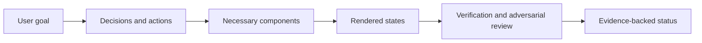

# Product UI QA

Review, implement, and verify interfaces against the user's actual task, including whether each visible component needs to exist.

## Primary capabilities

| Capability | What it does |
| --- | --- |
| Component necessity | Derives decisions, information, actions, and visible state before choosing UI components; classifies redundant or implementation-driven elements |
| Product-level quality gates | Reviews truthful status, recovery, task completion, identity boundaries, information hierarchy, and consistency |
| State-based verification | Selects meaningful combinations of data volume, async state, permissions, connectivity, input, viewport, and language |
| Two-pass completion review | Checks requirements first, then challenges the rendered product for unnecessary, misleading, missing, or inaccessible UI |

## Supporting capabilities

- P0–P3 severity definitions and a structured QA report.
- Review-only, implementation, and implementation-plus-verification modes.
- Manual and automated accessibility evidence kept distinct.
- A removal challenge that preserves essential navigation, safety, trust, and recovery.

## Workflow

1. Establish requirements and the primary user journey.
2. Run the component necessity gate before a new screen or substantial redesign.
3. Choose relevant quality gates and a risk-based state matrix.
4. Implement if authorized, then inspect the running interface.
5. Audit the rendered component set and conduct a fresh adversarial review.
6. Fix in-scope critical defects, rerun affected checks, and report evidence and gaps.



## Architecture

[SKILL.md](SKILL.md) coordinates seven focused references: [component necessity](references/component-necessity-and-minimal-ui.md), [quality gates](references/ui-quality-gates.md), [state matrix](references/state-matrix.md), [semantic audit](references/semantic-ui-audit.md), [accessibility](references/accessibility-checklist.md), [adversarial review](references/adversarial-review.md), and the [report template](references/final-qa-report-template.md).

This package contains no browser runner. The host's browser or native UI tools provide screenshots and interaction evidence. Existing project test tools supply automated checks. Companion skills can assist when installed; they are not required to read or apply this framework.

## Comparison and advantages

| Related skill | Useful distinction |
| --- | --- |
| Vercel `web-design-guidelines` | A focused code review against maintained interface rules. This skill adds a component-necessity decision chain, relevant runtime states, and a product-level completion report. |
| Anthropic `webapp-testing` | Supplies concrete Playwright interaction and server-management mechanics. This skill supplies the product judgments that determine which states and user outcomes those mechanics should prove. |

The strongest reason to choose this skill is a UI that works technically but contains unnecessary controls, misleading states, or an incomplete recovery journey. Choose the narrower alternatives when file-level findings or browser mechanics are sufficient. Sources and review versions: [comparison record](../../docs/comparisons.md#product-ui-qa).

## Usage

Install with the [collection instructions](../../README.md#install-and-use), then provide the running application, requirements, and intended mode:

```text
$product-ui-qa
Review this document-upload workflow without changing code. The primary user
must upload a file, understand processing progress, recover from failure, and
open the result. Check empty, processing, failed, and completed states at the
main desktop and mobile viewports. Return prioritized findings with evidence.
```

**Illustrative finding, not a measured result:** a permanent “worker version” card may be moved to diagnostics if it supports no user decision, while a retry control remains visible in the failed state.

**Output:** a scoped QA report, evidence locations, defects and severity, fixes when requested, and a supported final status.

## Limits and verification

Rendered inspection is necessary for visual claims. Automated accessibility checks alone do not establish compliance, and agent review is not real-user usability testing. The package has been structurally checked; its effect on product outcomes has not been benchmarked. See [verification](../../docs/verification.md).
