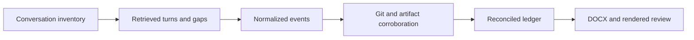

# Project History Archivist

Reconstruct a project's accessible Codex conversations and development record into one evidence-traceable DOCX.

## Primary capabilities

| Capability | What it does |
| --- | --- |
| Complete accessible inventory | Includes relevant active, archived, renamed, and worktree-related conversations; accounts for partial and inaccessible records |
| Chronological reconstruction | Preserves substantive prompts, replies, progress, actions, failures, reversions, and subsequent decisions |
| Conversation–Git corroboration | Distinguishes a proposed change, an actual edit, and verified behavior; tracks contradictory evidence |
| Reviewable document delivery | Produces a navigable archive with a timeline, per-conversation records, synthesis, and evidenced current state |

## Supporting capabilities

- Durable ledgers and normalized records for resumable investigation.
- `OBSERVED`, `CORROBORATED`, `INFERRED`, and `UNKNOWN` evidence labels.
- Explicit definitions for conversation, prompt, changed-file, and correlated-commit counts.
- A standard-library Python helper that detects structural contradictions in a normalized ledger.

## Workflow

1. Define the project boundary and as-of time; preserve repository state.
2. Enumerate relevant conversations before composing the narrative.
3. Retrieve accessible turns from beginning to end and checkpoint records.
4. Extract events and correlate material claims with Git, source, logs, or artifacts.
5. Reconcile coverage; preserve unavailable spans as named gaps.
6. Compose the DOCX, validate structure, render every page, and inspect layout.



## Architecture

[SKILL.md](SKILL.md) coordinates [retrieval](references/retrieval.md), [records](references/records.md), and [report construction](references/report.md). [check_archive.py](scripts/check_archive.py) checks counts, coverage flags, identifiers, and selected event invariants.

The host must supply legitimate conversation access, Git access, and a DOCX creation/rendering workflow. This package does not include a conversation exporter, access credentials, or a document-rendering engine. If only summaries or partial exports are accessible, the archive must retain that limitation.

## Comparison and advantages

| Related skill | Useful distinction |
| --- | --- |
| `codex-chat-export` | Provides direct Markdown/JSON export of Codex transcripts, including optional tool traces. This skill adds project membership reconciliation, event interpretation, Git corroboration, and a rendered narrative archive. |
| `session-synthesis` | Records session goals, outcomes, usage, and cost across supported coding hosts. This skill focuses on a project spanning conversations, detailed chronology, and independently supported current-state claims. |

Choose this skill for an engineering audit or a durable project record. Choose direct export for backup and session synthesis for a lightweight session log. Sources and review versions: [comparison record](../../docs/comparisons.md#project-history-archivist).

## Usage

Install with the [collection instructions](../../README.md#install-and-use):

```text
$project-history-archivist
Archive every accessible conversation associated with this repository,
including relevant archived tasks and worktrees, as of today. Preserve
substantive prompts and progress, corroborate implementation claims with Git,
and deliver one DOCX with explicit retrieval gaps and a verified current state.
```

Run the optional helper from this skill directory:

```sh
python3 scripts/check_archive.py examples/ledger.json
```

The [example ledger](examples/ledger.json) is synthetic and includes a fully inspected record and an inaccessible record with a named gap. A structurally valid ledger can still have incomplete coverage; a successful exit is not a completeness certificate.

**Output:** the DOCX, coverage counts, date range, evidence locations, and explicit remaining gaps.

## Limits and verification

Python **3.10+** is required only for the checker. It cannot determine whether a conversation was actually read, whether a source is truthful, or whether the DOCX is visually correct. Large project archives can require substantial time. Packaging and synthetic helper checks are documented in [verification](../../docs/verification.md); no private conversations or generated archive are distributed here.
