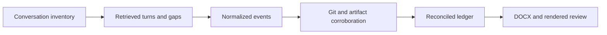
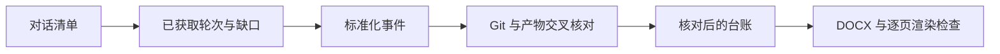

# Project History Archivist

[English](#english) | [中文版](#chinese-version)

<a name="english"></a>

Reconstruct a project's accessible Codex conversations and development record into one evidence-traceable DOCX.

## Primary capabilities

| Capability | What it does |
| --- | --- |
| Complete accessible inventory | Includes relevant active, archived, renamed, and worktree-related conversations; accounts for partial and inaccessible records |
| Chronological reconstruction | Preserves substantive prompts, replies, progress, actions, failures, reversions, and subsequent decisions |
| Conversation–Git corroboration | Distinguishes a proposed change, an actual edit, and verified behavior; tracks contradictory evidence |
| Reviewable document delivery | Produces a navigable archive with a timeline, per-conversation records, synthesis, and evidenced current state |

## Supporting capabilities

- Durable ledgers and normalized records for resumable investigation.
- `OBSERVED`, `CORROBORATED`, `INFERRED`, and `UNKNOWN` evidence labels.
- Explicit definitions for conversation, prompt, changed-file, and correlated-commit counts.
- A standard-library Python helper that detects structural contradictions in a normalized ledger.

## Workflow

1. Define the project boundary and as-of time; preserve repository state.
2. Enumerate relevant conversations before composing the narrative.
3. Retrieve accessible turns from beginning to end and checkpoint records.
4. Extract events and correlate material claims with Git, source, logs, or artifacts.
5. Reconcile coverage; preserve unavailable spans as named gaps.
6. Compose the DOCX, validate structure, render every page, and inspect layout.



## Architecture

[SKILL.md](SKILL.md) coordinates [retrieval](references/retrieval.md), [records](references/records.md), and [report construction](references/report.md). [check_archive.py](scripts/check_archive.py) checks counts, coverage flags, identifiers, and selected event invariants.

The host must supply legitimate conversation access, Git access, and a DOCX creation/rendering workflow. This package does not include a conversation exporter, access credentials, or a document-rendering engine. If only summaries or partial exports are accessible, the archive must retain that limitation.

## Comparison and advantages

| Related skill | Useful distinction |
| --- | --- |
| `codex-chat-export` | Provides direct Markdown/JSON export of Codex transcripts, including optional tool traces. This skill adds project membership reconciliation, event interpretation, Git corroboration, and a rendered narrative archive. |
| `session-synthesis` | Records session goals, outcomes, usage, and cost across supported coding hosts. This skill focuses on a project spanning conversations, detailed chronology, and independently supported current-state claims. |

Choose this skill for an engineering audit or a durable project record. Choose direct export for backup and session synthesis for a lightweight session log. Sources and review versions: [comparison record](../../docs/comparisons.md#project-history-archivist).

## Usage

Install with the [collection instructions](../../README.md#install-and-use):

```text
$project-history-archivist
Archive every accessible conversation associated with this repository,
including relevant archived tasks and worktrees, as of today. Preserve
substantive prompts and progress, corroborate implementation claims with Git,
and deliver one DOCX with explicit retrieval gaps and a verified current state.
```

Run the optional helper from this skill directory:

```sh
python3 scripts/check_archive.py examples/ledger.json
```

The [example ledger](examples/ledger.json) is synthetic and includes a fully inspected record and an inaccessible record with a named gap. A structurally valid ledger can still have incomplete coverage; a successful exit is not a completeness certificate.

**Output:** the DOCX, coverage counts, date range, evidence locations, and explicit remaining gaps.

## Limits and verification

Python **3.10+** is required only for the checker. It cannot determine whether a conversation was actually read, whether a source is truthful, or whether the DOCX is visually correct. Large project archives can require substantial time. Packaging and synthetic helper checks are documented in [verification](../../docs/verification.md); no private conversations or generated archive are distributed here.

---

<a name="chinese-version"></a>

## 中文版

[返回英文版](#english)

将项目中可访问的 Codex 对话和开发记录重建为一份证据可追溯的 DOCX 文档。

### 主要功能

| 功能 | 具体行为 |
| --- | --- |
| 完整的可访问记录清单 | 纳入相关的活跃、已归档、已重命名及工作树关联对话，并明确记录仅能部分获取或无法访问的情况 |
| 按时间顺序重建历史 | 保留实质性用户请求、回复、进展、操作、失败、回退和后续决策 |
| 对话与 Git 交叉核对 | 区分建议修改、实际编辑与已验证行为，并追踪相互矛盾的证据 |
| 可审查的文档交付 | 生成具备导航的档案，包含时间线、逐对话记录、综合分析，以及有证据支持的当前状态 |

### 辅助功能

- 持久化台账与标准化记录，支持中断后继续调查。
- 使用 `OBSERVED`（直接观察）、`CORROBORATED`（交叉印证）、`INFERRED`（推断）和 `UNKNOWN`（未知）证据标签。
- 明确定义对话数、用户请求数、修改文件数和关联提交数的统计口径。
- 提供仅依赖 Python 标准库的辅助脚本，识别标准化台账中的结构矛盾。

### 工作流程

1. 确定项目边界和统计截止时间，保留仓库初始状态。
2. 在撰写叙述前，先枚举相关对话。
3. 从头到尾读取可访问的轮次，持续保存处理进度。
4. 提取事件，将重要陈述与 Git、源码、日志或产物进行核对。
5. 核对覆盖情况，为无法取得的内容保留明确的缺口说明。
6. 编写 DOCX，验证文档结构，逐页渲染并检查布局。



### 架构设计

[SKILL.md](SKILL.md) 协调 [检索指南](references/retrieval.md)、[记录模型](references/records.md) 和 [报告构建](references/report.md)。[check_archive.py](scripts/check_archive.py) 检查数量统计、覆盖标志、标识符和部分事件约束。

宿主环境需要提供合法的对话访问、Git 访问，以及 DOCX 生成与渲染流程。本包不附带对话导出器、访问凭据或文档渲染引擎。如果只能访问摘要或部分导出，最终档案必须保留相应限制说明。

### 同类比较与优势

| 同类 skill | 工作重点与差异 |
| --- | --- |
| `codex-chat-export` | 将 Codex 对话直接导出为 Markdown／JSON，可包含工具轨迹。本 skill 增加了项目归属核对、事件解释、Git 交叉验证，以及经过渲染检查的叙述性档案。 |
| `session-synthesis` | 记录不同编程宿主中的会话目标、结果、用量与成本。本 skill 聚焦于跨多个对话的项目、详细时间线，以及由独立证据支持的当前状态。 |

需要工程审计或长期保存的项目记录时，适合使用本 skill。仅需备份时可以直接导出；仅需简洁会话日志时，可以使用会话总结工具。比较来源与核对版本见 [比较记录](../../docs/comparisons.md#project-history-archivist)。

### 使用方式

按 [集合安装说明](../../README.md#install-and-use) 安装后调用：

```text
$project-history-archivist
请以今天为截止时间，归档与此仓库有关的全部可访问对话，包括相关的已归档任务
和工作树。保留实质性用户请求与进展，用 Git 核对实现陈述，最终交付一份 DOCX，
明确列出检索缺口，并给出经核对的项目当前状态。
```

在该 skill 的目录内，可以运行可选检查器：

```sh
python3 scripts/check_archive.py examples/ledger.json
```

[示例台账](examples/ledger.json) 使用合成数据，包含一条已完整检查的记录，以及一条附有缺口说明的不可访问记录。台账即使结构有效，也可能覆盖不完整；程序成功退出不代表档案内容已完整。

**输出：** DOCX、覆盖数量、日期范围、证据位置和明确的剩余缺口。

### 能力边界与验证

只有运行检查器时才需要 **Python 3.10+**。它无法判断某段对话是否真的被读取、来源是否真实，或 DOCX 的视觉布局是否正确。大型项目归档可能需要较长时间。[验证记录](../../docs/verification.md) 说明了打包检查和合成数据检查的范围；本仓库不分发私人对话或已生成的项目档案。
