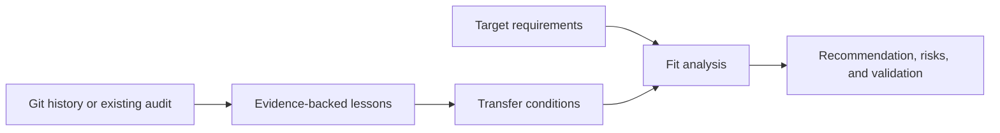
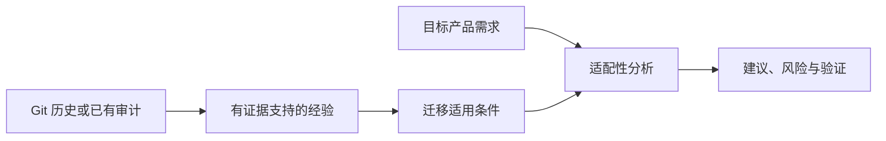

# Software History Lessons

[English](#english) | [中文版](#chinese-version)

<a name="english"></a>

Turn repository history or an existing audit into transferable engineering knowledge, then apply the relevant lessons to another product.

## Primary capabilities

| Capability | What it does |
| --- | --- |
| Repository reconstruction | Inventories scoped canonical history and inspects patches, merges, renames, superseded code, and fix chains |
| Experience distillation | Separates reusable code, reusable patterns, engineering experience, and approaches to avoid |
| Transfer analysis | Records when a lesson applies, when it does not, and what must be verified before reuse |
| Target-product synthesis | Links historical evidence to target requirements, recommendations, risks, and validation gates |

## Supporting capabilities

- Three composable modes: repository to experience, audit to experience, and experience to a new product.
- Read-only repository investigation with starting and ending state checks.
- Explicit `OBSERVED`, `INFERENCE`, `RECOMMENDATION`, and `UNKNOWN` labels.
- Optional durable DOCX output with rendered inspection.

## Workflow

1. Select Mode A for a repository, Mode B for an adequate supplied audit, and Mode C for a target product; combine modes when needed.
2. Inventory and inspect canonical history if Mode A applies; reuse sufficient audit evidence in Mode B.
3. Reconstruct important changes and failure/fix chains without inventing motives or ownership.
4. Distill lessons with provenance, applicability, counterconditions, and validation needs.
5. For Mode C, evaluate fit against the target and label uncovered needs as new requirements.
6. Deliver a traceable analysis or a validated document in the requested format.



## Architecture

[SKILL.md](SKILL.md) routes to four references: [repository forensics](references/repository-forensics.md), [experience distillation](references/experience-distillation.md), [target-product synthesis](references/target-product-synthesis.md), and [durable documents](references/durable-document.md).

The skill is an instruction workflow with no executable dependency. Git supplies historical objects; the agent synthesizes evidence and transfer conditions. A document toolchain is needed only for document delivery. A sufficient existing audit can bypass expensive repository reconstruction.

## Comparison and advantages

| Related skill | Useful distinction |
| --- | --- |
| `game-postmortem` in Skill2Env | Offers a project/milestone retrospective with quantitative evidence, patterns, lessons, and action items. This skill emphasizes patch-level history and an explicit fit analysis before transferring a lesson into a different product. |
| `session-synthesis` | Produces a reusable session log with outcomes and telemetry. This skill addresses repository-wide evolution and technical reuse decisions across projects. |

Choose this skill when “what did we learn?” must become a defensible architecture or implementation recommendation. A shorter retrospective is more suitable for immediate team action items. Sources and review versions: [comparison record](../../docs/comparisons.md#software-history-lessons).

## Usage

Install with the [collection instructions](../../README.md#install-and-use):

```text
$software-history-lessons
Use this completed project audit and the new product requirements. Extract
reusable code, patterns, experience, and approaches to avoid. For each proposed
design decision, show the source evidence, why it fits this product, risks,
and the validation needed. Do not repeat Git reconstruction unless necessary.
```

**Illustrative output, not a project finding:** a historical duplicate-job failure may justify idempotency checks in a new queue consumer when delivery semantics match. It does not by itself justify copying the old queue architecture.

**Output:** traceable lessons and, when requested, a target decision table, phased implementation recommendations, or a rendered DOCX.

## Limits and verification

Commit messages cannot establish motivation or personal ownership. Missing history, shallow clones, and unavailable artifacts limit conclusions. Complete patch inspection can be expensive; the scope must be explicit. Packaging has been checked, but the quality of generated recommendations has not been benchmarked. See [verification](../../docs/verification.md).

---

<a name="chinese-version"></a>

## 中文版

[返回英文版](#english)

将软件仓库历史或已有审计报告提炼为可迁移的工程知识，再把相关经验应用于另一个产品。

### 主要功能

| 功能 | 具体行为 |
| --- | --- |
| 仓库历史重建 | 清点纳入调查范围的全部历史，检查补丁、合并、重命名、被替代代码和缺陷修复链 |
| 经验提炼 | 区分可复用代码、可复用模式、工程经验，以及应避免的方法 |
| 迁移适用性分析 | 记录经验何时适用、何时不适用，以及复用前需要验证什么 |
| 目标产品方案推导 | 将历史证据与目标需求、建议、风险和验证条件关联起来 |

### 辅助功能

- 三种可组合模式：从仓库提炼经验、从审计报告提炼经验、将经验应用于新产品。
- 以只读方式调查仓库，并检查开始与结束时的仓库状态。
- 使用 `OBSERVED`（直接观察）、`INFERENCE`（推断）、`RECOMMENDATION`（建议）和 `UNKNOWN`（未知）标签。
- 按需输出适合长期保存的 DOCX，并进行渲染检查。

### 工作流程

1. 仓库输入使用模式 A；已有充分审计报告使用模式 B；需要为目标产品提出建议时使用模式 C。可按任务组合。
2. 模式 A 清点并检查纳入调查范围的全部历史；模式 B 复用充分的审计证据。
3. 重建重要变更与失败／修复链，不编造动机或个人归属。
4. 提炼经验，记录来源、适用条件、不适用条件和验证需求。
5. 在模式 C 中评估经验与目标产品的匹配程度，将历史经验未覆盖的需求标为新需求。
6. 按请求格式交付可追溯的分析，或经过验证的文档。



### 架构设计

[SKILL.md](SKILL.md) 根据任务加载四份参考资料：[仓库取证](references/repository-forensics.md)、[经验提炼](references/experience-distillation.md)、[目标产品方案推导](references/target-product-synthesis.md) 和 [长期保存的文档](references/durable-document.md)。

本 skill 是指令工作流，没有可执行程序依赖。Git 提供历史对象，智能体综合证据并判断迁移条件。只有交付文档时才需要文档工具链。已有充分审计报告时，可以跳过成本较高的仓库历史重建。

### 同类比较与优势

| 同类 skill | 工作重点与差异 |
| --- | --- |
| Skill2Env 中的 `game-postmortem` | 提供包含定量证据、模式、经验和行动项的项目／里程碑复盘。本 skill 更强调补丁层面的历史，并在将经验迁移到另一个产品前显式分析适配性。 |
| `session-synthesis` | 生成包含结果和用量信息的可复用会话日志。本 skill 关注整个仓库的演进，以及跨项目的技术复用决策。 |

当“我们学到了什么”需要进一步转化为有依据的架构或实施建议时，适合使用本 skill。如果目标只是安排团队近期行动，较简短的复盘可能更合适。比较来源与核对版本见 [比较记录](../../docs/comparisons.md#software-history-lessons)。

### 使用方式

按 [集合安装说明](../../README.md#install-and-use) 安装后调用：

```text
$software-history-lessons
请根据这份已完成的项目审计和新产品需求，提炼可复用代码、模式、经验，以及
应避免的方法。对每项设计建议，说明来源证据、为何适合这个产品、相关风险和
所需验证。除非确有必要，不要重复重建 Git 历史。
```

**示意输出，并非真实项目发现：** 如果新旧系统的消息投递语义相同，历史上的任务重复执行故障可以支持“为新队列消费者增加幂等性检查”的建议；这并不自动支持照搬旧队列架构。

**输出：** 可追溯的经验；根据请求，还可提供目标决策表、分阶段实施建议，或经过渲染检查的 DOCX。

### 能力边界与验证

提交说明无法单独证明动机或个人贡献归属。历史缺失、浅克隆和无法取得的产物都会限制结论。完整补丁检查可能成本较高，因此需要明确范围。本包已完成打包检查，但生成建议的质量尚未经过基准测试。详见 [验证记录](../../docs/verification.md)。
