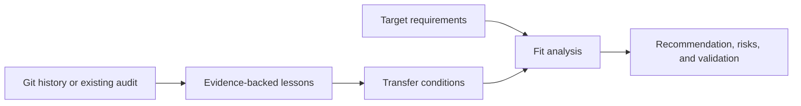

# Software History Lessons

Turn repository history or an existing audit into transferable engineering knowledge, then apply the relevant lessons to another product.

## Primary capabilities

| Capability | What it does |
| --- | --- |
| Repository reconstruction | Inventories scoped canonical history and inspects patches, merges, renames, superseded code, and fix chains |
| Experience distillation | Separates reusable code, reusable patterns, engineering experience, and approaches to avoid |
| Transfer analysis | Records when a lesson applies, when it does not, and what must be verified before reuse |
| Target-product synthesis | Links historical evidence to target requirements, recommendations, risks, and validation gates |

## Supporting capabilities

- Three composable modes: repository to experience, audit to experience, and experience to a new product.
- Read-only repository investigation with starting and ending state checks.
- Explicit `OBSERVED`, `INFERENCE`, `RECOMMENDATION`, and `UNKNOWN` labels.
- Optional durable DOCX output with rendered inspection.

## Workflow

1. Select Mode A for a repository, Mode B for an adequate supplied audit, and Mode C for a target product; combine modes when needed.
2. Inventory and inspect canonical history if Mode A applies; reuse sufficient audit evidence in Mode B.
3. Reconstruct important changes and failure/fix chains without inventing motives or ownership.
4. Distill lessons with provenance, applicability, counterconditions, and validation needs.
5. For Mode C, evaluate fit against the target and label uncovered needs as new requirements.
6. Deliver a traceable analysis or a validated document in the requested format.



## Architecture

[SKILL.md](SKILL.md) routes to four references: [repository forensics](references/repository-forensics.md), [experience distillation](references/experience-distillation.md), [target-product synthesis](references/target-product-synthesis.md), and [durable documents](references/durable-document.md).

The skill is an instruction workflow with no executable dependency. Git supplies historical objects; the agent synthesizes evidence and transfer conditions. A document toolchain is needed only for document delivery. A sufficient existing audit can bypass expensive repository reconstruction.

## Comparison and advantages

| Related skill | Useful distinction |
| --- | --- |
| `game-postmortem` in Skill2Env | Offers a project/milestone retrospective with quantitative evidence, patterns, lessons, and action items. This skill emphasizes patch-level history and an explicit fit analysis before transferring a lesson into a different product. |
| `session-synthesis` | Produces a reusable session log with outcomes and telemetry. This skill addresses repository-wide evolution and technical reuse decisions across projects. |

Choose this skill when “what did we learn?” must become a defensible architecture or implementation recommendation. A shorter retrospective is more suitable for immediate team action items. Sources and review versions: [comparison record](../../docs/comparisons.md#software-history-lessons).

## Usage

Install with the [collection instructions](../../README.md#install-and-use):

```text
$software-history-lessons
Use this completed project audit and the new product requirements. Extract
reusable code, patterns, experience, and approaches to avoid. For each proposed
design decision, show the source evidence, why it fits this product, risks,
and the validation needed. Do not repeat Git reconstruction unless necessary.
```

**Illustrative output, not a project finding:** a historical duplicate-job failure may justify idempotency checks in a new queue consumer when delivery semantics match. It does not by itself justify copying the old queue architecture.

**Output:** traceable lessons and, when requested, a target decision table, phased implementation recommendations, or a rendered DOCX.

## Limits and verification

Commit messages cannot establish motivation or personal ownership. Missing history, shallow clones, and unavailable artifacts limit conclusions. Complete patch inspection can be expensive; the scope must be explicit. Packaging has been checked, but the quality of generated recommendations has not been benchmarked. See [verification](../../docs/verification.md).
