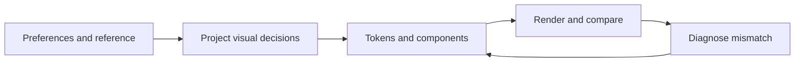

# Visual Convergence

Bring an existing interface into alignment with approved visual references and explicit preferences while preserving the product behavior within scope.

## Primary capabilities

| Capability | What it does |
| --- | --- |
| Preference and authority resolution | Prioritizes current user instructions, approved references, maintained project decisions, then implementation |
| Reference interpretation | Separates transferable visual invariants from geometry, content, or viewport details that need adaptation |
| Perceptual diagnosis | Checks hierarchy, visual weight, color dominance, density, and atmosphere in addition to exact tokens |
| Rendered convergence loop | Records expected versus actual appearance, diagnoses the cause, applies a focused fix, and renders again |

## Supporting capabilities

- Confidence levels for explicit preferences, repeated evidence, tentative inferences, and incidental reference details.
- A concise project visual source-of-truth template.
- P0–P3 prioritization by perceptual impact.
- Accessibility, responsive behavior, and functionality included in the stopping criteria.

## Workflow

1. Read the existing design system and approved references; capture the baseline.
2. Resolve conflicts and update the project's visual source of truth.
3. Translate qualitative feedback into variables such as saturation, accent area, density, or spacing.
4. Implement through semantic tokens and shared components.
5. Render and compare both specified values and the whole-screen composition.
6. Diagnose mismatches, iterate by impact, and stop when material differences are resolved or explicitly accepted.



## Architecture

Three layers remain separate: the reusable method in [SKILL.md](SKILL.md), product-specific decisions recorded using the [source-of-truth template](references/source-of-truth-template.md), and the product's implementation. A particular brand color or aesthetic never becomes a universal skill rule.

There are no bundled image-diff scripts, design assets, browser drivers, or numerical similarity model. The host supplies rendering and inspection tools; the agent interprets composition and explains its judgment.

## Comparison and advantages

| Related skill | Useful distinction |
| --- | --- |
| Anthropic `frontend-design` | Supports distinctive visual direction, deliberate typography, restraint, and self-critique. This skill concentrates on convergence to an already approved direction, preference confidence, and diagnosing token-correct but perceptually wrong results. |
| Vercel `web-design-guidelines` | Provides maintained interface rules for code review. This skill adds a persistent project visual specification and iterative whole-viewport comparison to a particular reference. |

Choose this skill when “the right colors are present, but the screen still feels wrong.” Use a design-generation skill when the task is open-ended creation. Sources and review versions: [comparison record](../../docs/comparisons.md#visual-convergence).

## Usage

Install with the [collection instructions](../../README.md#install-and-use):

```text
$visual-convergence
Refine the existing dashboard toward the approved screenshot. Preserve the
navigation and data workflow. The result feels too colorful despite matching
the palette. Compare accent area, surface hierarchy, and visual weight;
update the project's visual decisions and verify the affected viewports.
```

**Illustrative diagnosis:** a blue token may be correct while blue occupies most panels instead of a small informational accent. Fix the surface-role distribution before adjusting the hex value.

**Output:** updated project visual decisions, scoped implementation changes, before/after rendered evidence, and remaining intentional differences.

## Limits and verification

This is a judgment framework, not a pixel-identical reproduction guarantee. It needs an existing product and a sufficiently explicit direction. Without rendering access, the result must be reported as unverified visually. No controlled comparison of aesthetic outcomes has been performed; see [verification](../../docs/verification.md).
