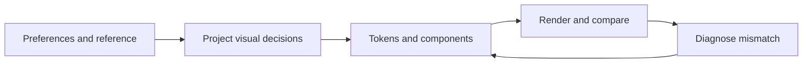

# Visual Convergence

[English](#english) | [中文版](#chinese-version)

<a name="english"></a>

Bring an existing interface into alignment with approved visual references and explicit preferences while preserving the product behavior within scope.

## Primary capabilities

| Capability | What it does |
| --- | --- |
| Preference and authority resolution | Prioritizes current user instructions, approved references, maintained project decisions, then implementation |
| Reference interpretation | Separates transferable visual invariants from geometry, content, or viewport details that need adaptation |
| Perceptual diagnosis | Checks hierarchy, visual weight, color dominance, density, and atmosphere in addition to exact tokens |
| Rendered convergence loop | Records expected versus actual appearance, diagnoses the cause, applies a focused fix, and renders again |

## Supporting capabilities

- Confidence levels for explicit preferences, repeated evidence, tentative inferences, and incidental reference details.
- A concise project visual source-of-truth template.
- P0–P3 prioritization by perceptual impact.
- Accessibility, responsive behavior, and functionality included in the stopping criteria.

## Workflow

1. Read the existing design system and approved references; capture the baseline.
2. Resolve conflicts and update the project's visual source of truth.
3. Translate qualitative feedback into variables such as saturation, accent area, density, or spacing.
4. Implement through semantic tokens and shared components.
5. Render and compare both specified values and the whole-screen composition.
6. Diagnose mismatches, iterate by impact, and stop when material differences are resolved or explicitly accepted.



## Architecture

Three layers remain separate: the reusable method in [SKILL.md](SKILL.md), product-specific decisions recorded using the [source-of-truth template](references/source-of-truth-template.md), and the product's implementation. A particular brand color or aesthetic never becomes a universal skill rule.

There are no bundled image-diff scripts, design assets, browser drivers, or numerical similarity model. The host supplies rendering and inspection tools; the agent interprets composition and explains its judgment.

## Comparison and advantages

| Related skill | Useful distinction |
| --- | --- |
| Anthropic `frontend-design` | Supports distinctive visual direction, deliberate typography, restraint, and self-critique. This skill concentrates on convergence to an already approved direction, preference confidence, and diagnosing token-correct but perceptually wrong results. |
| Vercel `web-design-guidelines` | Provides maintained interface rules for code review. This skill adds a persistent project visual specification and iterative whole-viewport comparison to a particular reference. |

Choose this skill when “the right colors are present, but the screen still feels wrong.” Use a design-generation skill when the task is open-ended creation. Sources and review versions: [comparison record](../../docs/comparisons.md#visual-convergence).

## Usage

Install with the [collection instructions](../../README.md#install-and-use):

```text
$visual-convergence
Refine the existing dashboard toward the approved screenshot. Preserve the
navigation and data workflow. The result feels too colorful despite matching
the palette. Compare accent area, surface hierarchy, and visual weight;
update the project's visual decisions and verify the affected viewports.
```

**Illustrative diagnosis:** a blue token may be correct while blue occupies most panels instead of a small informational accent. Fix the surface-role distribution before adjusting the hex value.

**Output:** updated project visual decisions, scoped implementation changes, before/after rendered evidence, and remaining intentional differences.

## Limits and verification

This is a judgment framework, not a pixel-identical reproduction guarantee. It needs an existing product and a sufficiently explicit direction. Without rendering access, the result must be reported as unverified visually. No controlled comparison of aesthetic outcomes has been performed; see [verification](../../docs/verification.md).

---

<a name="chinese-version"></a>

## 中文版

[返回英文版](#english)

在任务范围内保留产品行为，让现有界面逐步接近已确认的视觉参考和明确偏好。

### 主要功能

| 功能 | 具体行为 |
| --- | --- |
| 偏好与依据优先级判断 | 依次优先考虑用户当前指令、已确认的参考、项目维护的设计决策，以及现有实现 |
| 参考解读 | 将应保留的视觉特征，与需要根据实际产品调整的几何尺寸、内容和视口细节分开 |
| 整体观感诊断 | 除了核对设计参数，还检查层级、视觉权重、颜色主导关系、密度和氛围 |
| 渲染与收敛循环 | 记录预期与实际外观的差异，诊断原因，针对性修改，再次渲染检查 |

### 辅助功能

- 区分明确偏好、重复证据、暂定推断和参考图偶然细节的可信程度。
- 提供简洁的项目视觉规范模板，作为统一依据。
- 按感知影响划分 P0–P3 优先级。
- 将无障碍要求、响应式行为和功能完整性纳入停止迭代的条件。

### 工作流程

1. 阅读现有设计系统和已确认参考，记录初始渲染结果。
2. 解决依据冲突，更新项目的统一视觉规范。
3. 将定性反馈转化为饱和度、强调色面积、密度、间距等可检查变量。
4. 通过语义化设计参数和共享组件实施修改。
5. 渲染界面，同时比较指定参数与整个视口的构图效果。
6. 诊断差异，按影响大小迭代；重要差异已解决或被明确接受后停止。


### 架构设计

保持三层独立：[SKILL.md](SKILL.md) 中的可复用方法、借助 [统一视觉规范模板](references/source-of-truth-template.md) 记录的产品特定决策，以及产品的实际实现。某个项目的品牌色或审美偏好不会成为所有项目都必须遵循的 skill 规则。

本 skill 不附带图像差分脚本、设计素材、浏览器驱动或数值相似度模型。渲染和检查工具由宿主环境提供，智能体负责解读构图并说明判断依据。

### 同类比较与优势

| 同类 skill | 工作重点与差异 |
| --- | --- |
| Anthropic `frontend-design` | 支持有辨识度的视觉方向、经过考虑的排版、克制表达与自我审查。本 skill 更聚焦于接近已有确认方向、判断偏好可信程度，以及诊断“参数正确但观感不对”的结果。 |
| Vercel `web-design-guidelines` | 为代码审查提供持续维护的界面规则。本 skill 增加了可持续维护的项目视觉规范，以及围绕具体参考进行的整个视口反复比较。 |

当“该用的颜色都有，但整个页面仍然感觉不对”时，适合使用本 skill。开放式设计创作可以优先使用设计生成类 skill。比较来源与核对版本见 [比较记录](../../docs/comparisons.md#visual-convergence)。

### 使用方式

按 [集合安装说明](../../README.md#install-and-use) 安装后调用：

```text
$visual-convergence
请根据已确认的截图调整现有仪表盘，保留导航和数据操作流程。虽然调色板一致，
当前页面仍显得过于鲜艳。请比较强调色面积、表面层级和视觉权重，更新项目视觉
规范，并验证受影响的视口。
```

**示意诊断：** 蓝色的具体数值可能正确，但蓝色占据了大部分面板，而参考中它只承担少量信息提示的作用。此时应先修正不同表面的语义角色与面积分配，再考虑修改颜色值。

**输出：** 更新后的项目视觉决策、范围内的实现改动、修改前后的实际渲染证据，以及保留的有意差异。

### 能力边界与验证

这是辅助视觉判断的框架，不能保证像素级复刻。它需要一个已有产品和足够明确的视觉方向。无法访问渲染结果时，必须明确说明视觉效果尚未验证。尚未开展审美结果的受控对照实验；详见 [验证记录](../../docs/verification.md)。
